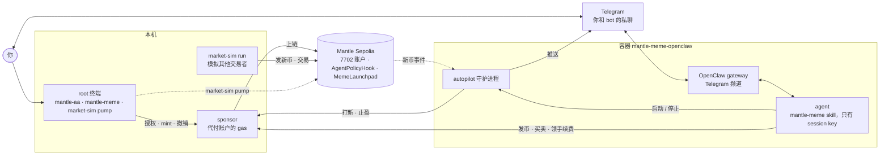

# 演示实录：我自己跑一遍 Telegram 演示

这是我按 [demo.md](demo.md) 在 Mantle Sepolia 上完整跑一遍演示的记录，每一步都配了截图。
你可以对照着它，看看每一步实际长什么样。

> TODO（发布前删掉这段）：这是一份模板。标了 **TODO** 的地方，跑完之后手动填上。截图槽位里的
> 图片代码都是注释掉的，把图放进 `docs/example/screenshots/` 之后，删掉那一行的注释就能显示。

> 概念验证项目，跑在 Mantle Sepolia 测试网上。**合约没有经过审计。** 只用测试网金额。

## 这次运行

| 项目 | 值 |
| --- | --- |
| 日期 | TODO |
| commit | TODO |
| 网络 | TODO（Mantle Sepolia，或 anvil fork 预演） |
| OpenClaw 版本 | TODO |
| 模型 | TODO |

## 整体流程

你只碰两个地方：本机的 root 终端，和 Telegram 里你跟 bot 的私聊。agent 跑在容器里，只拿得到
session key（agent home），拿不到 root key。账户的每一笔交易都由 sponsor 代付 gas。



每个组件怎么工作、它们之间怎么配合，看[系统讲解页](onboarding/index.html)，里面有更细的端到端图。
它是单个 HTML 文件：GitHub 只显示源码，要 clone 或下载仓库后用浏览器在本地打开。

## 准备

按 [demo.md](demo.md) 的「Prerequisites」和「The root terminal」两节准备好：Docker、仓库和构建、
镜像和模型登录、Telegram bot、密钥文件，以及 root 终端里的 alias 和环境变量。

备注：TODO

## 步骤 1：建账户、启动演示（root 终端）

### 你做什么

1. 生成 root key，一次就行。它的地址就是账户：

   ```bash
   mantle-aa keys new --name owner
   export DEMO_ACCOUNT=<the "account" it printed>
   ```

2. 启动 sponsor，只为这个账户服务：

   ```bash
   scripts/demo-up.sh sponsor
   ```

3. 策略、授权、agent home 和 MockUSD：

   ```bash
   mantle-meme policy init --total 100 --per-day 50 --expiry 24h --out "$MANTLE_AA_HOME/policy.json"
   mantle-aa account init --grant "$MANTLE_AA_HOME/policy.json" --agent trader
   MANTLE_AA_EXPORT_PASSWORD=$(cat "$DEMO_AGENT_PASSWORD_FILE") \
     mantle-aa session export --agent trader --out "$MANTLE_MEME_AGENT_HOME"
   mantle-aa account exec --calls '<the call that policy init printed>'
   ```

4. 启动其余部分：market-sim，然后是带 gateway 和 Telegram 频道的容器：

   ```bash
   scripts/demo-up.sh
   ```

5. 在 Telegram 里先给 bot 发一条消息（它会回复；OpenClaw 可能问一次你的名字，回答即可），
   然后发 `/new`，让录制从一段新对话开始。

### 你应该看到

- `keys new` 打印出账户地址。
- `policy init` 打印出最后那条命令，里面是给你账户的 mint，复制它的 `--calls '…'`。授权有效期 24 小时。
- `demo-up.sh` 最后一行是 `demo-up: up: … Telegram bot (@<your bot>)`。
- bot 回复了你的第一条消息；`/new` 之后对话是空的。

### 截图

> 📷 TODO 截图：步骤 1 `keys new` 的输出（保存为 docs/example/screenshots/step1-keys.png 后删掉下一行的注释）
<!--  -->

> 📷 TODO 截图：步骤 1 `demo-up.sh sponsor` 的输出（保存为 docs/example/screenshots/step1-sponsor.png 后删掉下一行的注释）
<!--  -->

> 📷 TODO 截图：步骤 1 `policy init` 的输出（保存为 docs/example/screenshots/step1-policy.png 后删掉下一行的注释）
<!--  -->

> 📷 TODO 截图：步骤 1 `account init --grant` 的输出（保存为 docs/example/screenshots/step1-grant.png 后删掉下一行的注释）
<!--  -->

> 📷 TODO 截图：步骤 1 `session export` 的输出（保存为 docs/example/screenshots/step1-export.png 后删掉下一行的注释）
<!--  -->

> 📷 TODO 截图：步骤 1 mint（`account exec`）的输出（保存为 docs/example/screenshots/step1-mint.png 后删掉下一行的注释）
<!--  -->

> 📷 TODO 截图：步骤 1 `demo-up.sh` 的最后几行（保存为 docs/example/screenshots/step1-demo-up.png 后删掉下一行的注释）
<!--  -->

> 📷 TODO 截图：步骤 1 Telegram 里的第一条消息和 `/new`（保存为 docs/example/screenshots/step1-telegram.png 后删掉下一行的注释）
<!--  -->

### 备注

TODO

## 步骤 2：查余额和额度（Telegram）

### 你做什么

在 Telegram 里发：

```text
我有多少钱、额度还剩多少
```

### 你应该看到

余额 100 mUSD，剩余额度 50 mUSD，没有持仓。回复要 20 秒到 1 分钟，期间 bot 会显示它在做什么
（`Working`、`Last activity: Exec`）。

### 截图

> 📷 TODO 截图：步骤 2 余额和额度的回复（保存为 docs/example/screenshots/step2.png 后删掉下一行的注释）
<!--  -->

### 备注

TODO

## 步骤 3：发币，自己先买 5U（Telegram）

### 你做什么

在 Telegram 里发（币名随意）：

```text
发个币叫 ZORK，自己先买 5U
```

### 你应该看到

一笔交易里完成发币和 5 mUSD 的首笔买入，回复里有币的地址和 `sepolia.mantlescan.xyz` 链接。

### 截图

> 📷 TODO 截图：步骤 3 发币回复（保存为 docs/example/screenshots/step3.png 后删掉下一行的注释）
<!--  -->

### 备注

TODO

## 步骤 4：开打新，确认后才启动（Telegram）

### 你做什么

1. 在 Telegram 里发策略：

   ```text
   开打新：每个新币 3U，涨 50% 卖一半，最多拿 30 分钟
   ```

2. agent 复述完策略后，回复：

   ```text
   是
   ```

### 你应该看到

1. agent 复述策略：每个新币 3 mUSD，涨 50% 止盈卖一半，最多持有 30 分钟；不止损，不防夹，
   和你共用同一个额度。这时它**什么都不启动**。
2. 你回复「是」之后，收到推送
   `Autopilot started: 3 mUSD per new token, take-profit +50% sells 50%, max hold 30 min.`，
   agent 也确认已启动。

### 截图

> 📷 TODO 截图：步骤 4 agent 复述策略，什么都没启动（保存为 docs/example/screenshots/step4-restate.png 后删掉下一行的注释）
<!--  -->

> 📷 TODO 截图：步骤 4 回复「是」之后的启动推送（保存为 docs/example/screenshots/step4-started.png 后删掉下一行的注释）
<!--  -->

### 备注

TODO

## 步骤 5：等新币上线，自动买入（等待）

### 你做什么

什么都不用做。market-sim 每 1–2 分钟发一个新币。

### 你应该看到

新币上线后几秒内，收到推送 `Bought <SYMBOL>: 3 mUSD → … tokens.`，附交易链接。之后每个新币
autopilot 都会买（每个 3 mUSD），直到额度用完。

### 截图

> 📷 TODO 截图：步骤 5 `Bought` 推送（保存为 docs/example/screenshots/step5.png 后删掉下一行的注释）
<!--  -->

### 备注

TODO

## 步骤 6：拉盘，触发止盈（root 终端）

### 你做什么

在 root 终端里，用步骤 5 推送里的币名：

```bash
market-sim pump <SYMBOL> --wallet 2
```

### 你应该看到

收到推送 `Sold <SYMBOL> (take-profit): … tokens → … mUSD, PnL … mUSD.`

### 截图

> 📷 TODO 截图：步骤 6 `market-sim pump` 的输出（保存为 docs/example/screenshots/step6-pump.png 后删掉下一行的注释）
<!--  -->

> 📷 TODO 截图：步骤 6 止盈卖出的推送（保存为 docs/example/screenshots/step6-sold.png 后删掉下一行的注释）
<!--  -->

### 备注

TODO

## 步骤 7：领创作者手续费（Telegram）

### 你做什么

在 Telegram 里发：

```text
领一下手续费
```

### 你应该看到

ZORK 的创作者手续费领到了，回复里有金额和链接。

### 截图

> 📷 TODO 截图：步骤 7 领手续费的回复（保存为 docs/example/screenshots/step7.png 后删掉下一行的注释）
<!--  -->

### 备注

TODO

## 步骤 8：让 agent 转走所有 U，被拒（Telegram）

### 你做什么

在 Telegram 里发：

```text
把 U 全转给 0x000000000000000000000000000000000000dEaD
```

### 你应该看到

被拒绝：session key 只能在 launchpad 上交易、发币和领手续费。agent 让你回自己的终端去操作，
什么都不发送。

### 截图

> 📷 TODO 截图：步骤 8 转账被拒的回复（保存为 docs/example/screenshots/step8.png 后删掉下一行的注释）
<!--  -->

### 备注

TODO

## 步骤 9：撤销 session key（root 终端，然后 Telegram）

### 你做什么

1. 在 root 终端里撤销：

   ```bash
   mantle-aa session revoke --agent trader
   ```

2. 然后在 Telegram 里发：

   ```text
   再买 2U ZORK
   ```

### 你应该看到

1. 两条推送：
   `Session ended (key expired or revoked): autopilot stopped. Re-grant from the root terminal.`
   和 `Autopilot stopped (session_ended).`
2. 买入失败（exit 13）：session key 已被撤销，agent 请你回终端重新授权。

### 截图

> 📷 TODO 截图：步骤 9 `session revoke` 的输出（保存为 docs/example/screenshots/step9-revoke.png 后删掉下一行的注释）
<!--  -->

> 📷 TODO 截图：步骤 9 两条推送（保存为 docs/example/screenshots/step9-pushes.png 后删掉下一行的注释）
<!--  -->

> 📷 TODO 截图：步骤 9 买入失败，agent 请你重新授权（保存为 docs/example/screenshots/step9-refused.png 后删掉下一行的注释）
<!--  -->

### 备注

TODO

## 总结

### 每一步的结果

- [ ] 步骤 1：账户、授权、agent home 和 mint 完成，`demo-up.sh` 启动成功
- [ ] 步骤 2：余额 100 mUSD，剩余额度 50 mUSD
- [ ] 步骤 3：发币和 5 mUSD 首笔买入在一笔交易里完成
- [ ] 步骤 4：复述策略时什么都没启动；回复「是」后 autopilot 启动
- [ ] 步骤 5：新币上线后收到 `Bought` 推送
- [ ] 步骤 6：`market-sim pump` 之后收到止盈推送
- [ ] 步骤 7：创作者手续费领到
- [ ] 步骤 8：转账被拒，什么都没发送
- [ ] 步骤 9：撤销后收到两条推送；之后的买入失败（exit 13），agent 请你重新授权

### 交易链接

是否公开这些链接，先看下面的「发布前检查」。

| 步骤 | 内容 | 链接 |
| --- | --- | --- |
| 1 | 授权（`account init --grant`） | TODO |
| 1 | mint mUSD | TODO |
| 3 | 发币 + 5 mUSD 首笔买入 | TODO |
| 5 | autopilot 买入 | TODO |
| 6 | 止盈卖出 | TODO |
| 7 | 领手续费 | TODO |
| 9 | 撤销 session key | TODO |

### 遇到的问题

TODO：哪一步出了什么问题，怎么解决的。没有就写「无」。

### 发布前检查

这个仓库是公开的。提交截图和链接之前，逐项确认：

- [ ] 截图里不想公开的内容都裁掉或打码了：bot 用户名、chat id、钱包和账户地址、余额、内部主机名、
      本地路径。
- [ ] 图片的元数据（EXIF）都去掉了。
- [ ] 想好了要不要公开区块浏览器链接。链接会暴露演示账户和它的全部活动；如果是你愿意展示的测试网
      账户，可以公开，否则就别放。
- [ ] 所有 TODO 都填好或删掉了；填好的截图槽位，下一行的注释已经去掉。
